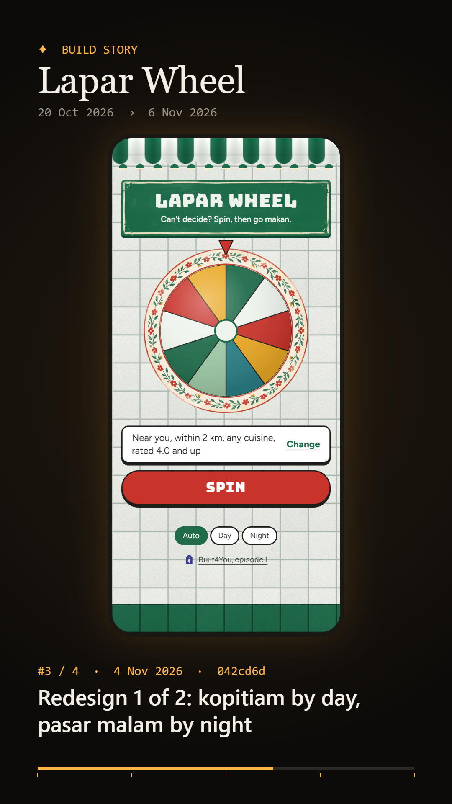

# Build Story

**A captioned 9:16 video of your web app growing, one frame per build, straight from git history.**

Build Story walks your repo's main line, builds the app at every commit that could change how it looks, screenshots each build on a phone-sized screen, and records a vertical video. Each frame carries the PR title and date, and there's a progress bar. It's made for build-in-public Reels and Stories.



## Run it

Needs Node 22.18 or later, Git, and Google Chrome (or Edge).

```bash
npx github:jasperntc/build-story path/to/your-app
```

It writes to `./build-story-<repo>/`:

- `story.mp4`: the video, 1080×1920 at 30 fps. Chrome records H.264 MP4 directly, which Instagram accepts.
- `cover.png`: a still frame to use as the cover.
- `frames/`: one screenshot per build.
- `build-errors.log`: why any commit didn't build.

## What it does

1. **Picks commits.** It takes first-parent history, so every merged PR is one step, captioned with the PR's title. Commits that only touch lockfiles, CI, docs, tests, data or scripts are skipped (`--all` keeps them). So are builds that look identical to the last one.
2. **Builds each one in a throwaway clone.** Your repo and working tree are never touched. Dependencies are reinstalled only when the lockfile changes. A commit that fails to build is logged and skipped.
3. **Screenshots it** in headless Chrome at a phone viewport, served from a loopback-only static server. A Next.js `basePath` is read from `next.config`.
4. **Records the video** in the same Chrome. A canvas draws the phone, caption and progress, and `MediaRecorder` encodes it, so no ffmpeg is needed.

## Options

| Flag | Default | What it does |
|---|---|---|
| `-o, --out <dir>` | `build-story-<repo>` | Where everything goes |
| `--build <cmd>` | `npm run build` | Build command, run in each checkout |
| `--dist <dir>` | `out` | Static folder the build writes |
| `--base <path>` | from `next.config` | URL base path |
| `--size <WxH>` | `390x844` | Phone viewport in CSS pixels (captured at 2×) |
| `--hold <s>` | `1.1` | Seconds each build stays on screen |
| `--settle <ms>` | `2500` | Wait after load, for fonts and entrance animations |
| `--title <text>` | repo name | Title in the video |
| `--max <n>` | all | At most n frames, picked evenly, always keeping the last |
| `--all` | off | Keep commits that only touch lockfiles, CI, docs or tests |
| `--keep` | off | Keep the temporary clone for debugging |

Works with any app whose build writes static files: Next.js `output: "export"`, Vite (`--dist dist`), Astro, and so on. Server-rendered apps aren't supported yet.

## How it's built

- **No runtime dependencies.** A small Chrome DevTools Protocol client (`src/chrome.ts`) drives your installed Chrome over Node's built-in WebSocket. No Puppeteer or Playwright download.
- **Static server** (`src/serve.ts`): loopback only. It maps static-export URLs (`/page`, `/page.html`, `/page/index.html`) under a base path and can never serve outside the build folder. Malformed URLs are a 404, not a crash.
- **Composer** (`assets/compose.html`): draws each frame on a 1080×1920 canvas, cross-fading between builds, and records it with `MediaRecorder`, preferring H.264 MP4.

```bash
npm install
npm test        # git parsing, commit filtering, static path mapping
npm run build
```

## Licence

MIT
